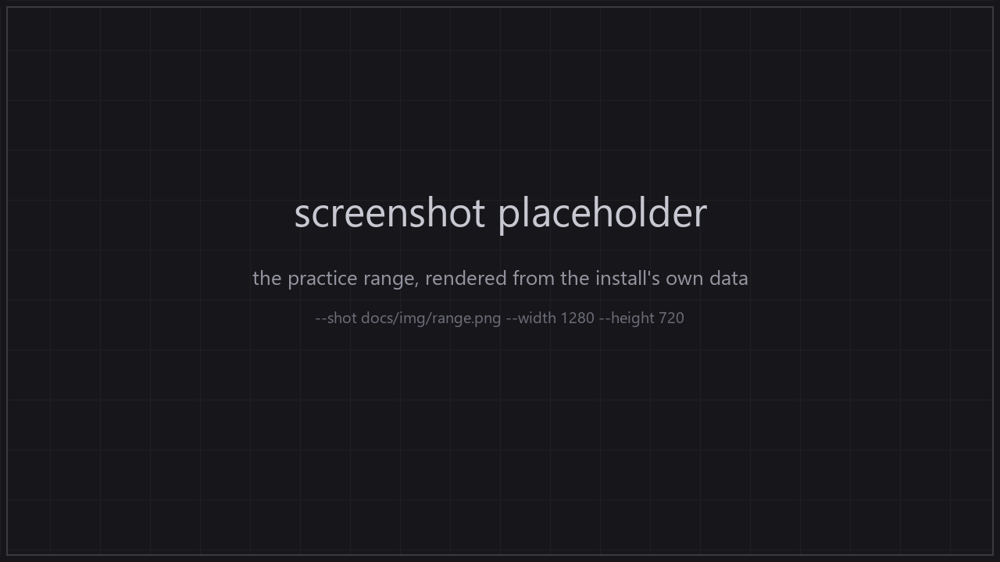

# overwatch-client-rs

A clean-room Rust reimplementation of the Overwatch client's gameplay:
movement, combat, the view model and the camera. It reads data from the
operator's own installation and behaviour from the complete current-build
`Overwatch.exe` image. Nothing from the game ships here.

**The rule: 1 to 1 or not at all.** A gameplay feature is implemented only when
the client's own code or value has been read and the Rust result is proven
identical. There is no "close enough" gameplay system. If the client's
expression has not been read, the feature is listed as open and is not
implemented. The current non-1:1 code is legacy debt in
[`docs/deviations.md`](docs/deviations.md); it is being removed.

**This repository contains no Blizzard content.** No art, models, sounds, maps,
textures, locale data, extracted tables or decompiled code — only original Rust
source and documentation. The tools open the installed game read-only and never
modify it. See [CREDITS.md](CREDITS.md).



*Placeholder: the last command of the quick start writes this file from your
install. Nothing captured from the game is committed.*

## Quick start

```sh
export OW_INSTALL='E:\Overwatch'                  # folder with .build.info
cargo run --release -p ow-client                  # the practice range; WASD walks
cargo run --release -p ow-client -- --walk-test   # movement trace and its assertions
cargo run --release -p ow-client -- --shot docs/img/range.png --width 1280 --height 720
```

A local Overwatch install is required — the tools read it in place and never
write to it — and the Rust toolchain is pinned by `rust-toolchain.toml`. The
gate is `cargo xtask verify` (`--fast` skips the install-reading tests); the
full flag list is under [Running it](#running-it).

## What works today

| system | state |
|---|---|
| practice-range launch: header → variation → scene map → chunk loader | works, 34/34 chunks (a viewer default: the image has no mode→variation selector) |
| walking on the map's own level collider | works: `ow-sim::walk`, swept by the verified type-3 mesh leaf |
| movement arithmetic: ramp, command, state transform, per-frame velocity law | verified, differential units against the client's bytes |
| jump and the airborne arc | verified: `ow-sim::jump`, `ow-sim::air` |
| CASC, STU, entities, weapon graphs, models, textures, maps | verified against the install |
| the model vertex-element decode and mesh assembly | open: the viewer's own reading, not client behaviour |
| the D3D11 renderer D1-D5 | partial: device, swap chain and frame step list; only `Present` has a read body |
| combat, materials, streaming, character collision, a client capture | open |

The evidence for every row is under [Status in depth](#status-in-depth); the
per-system ledger is [`docs/systems-coverage.md`](docs/systems-coverage.md).

## Status in depth

- [`docs/status-in-depth.md`](docs/status-in-depth.md) — the long-form status
  this README used to carry: the verified addresses, chunk counts and read
  values behind the table above.
- [`STATUS-handoff.md`](STATUS-handoff.md) — what works, what is open, what is
  next.
- [`docs/open-questions.md`](docs/open-questions.md) — the work queue, next
  thing at the top.
- [`MODLOG.md`](MODLOG.md) — how the project got here.

## Sources

- **Behaviour** comes from one place: the complete `Overwatch.exe` Ghidra
  image (base `0x140000000`, every `.text` page, the install's plaintext
  `.pdata`). Findings are recorded as an address and a conclusion, never as
  disassembly. `docs/ghidra-project.md` is the entry point, and
  `docs/ghidra-image-audit.md` states how far the analysis is trusted (the
  bytes are exact; three analysis defects are measured and listed for repair).
- **Data** comes from the operator's installation: formats, registries,
  geometry, values. Findings live in `docs/formats/` and are checked by tests
  that read the install.
- Only the current image and the operator's installation are sources.

## Running it

```sh
export OW_INSTALL='E:\Overwatch'                        # folder with .build.info
export OW_EXE='E:\Overwatch\_retail_\Overwatch.exe'     # optional; found under OW_INSTALL anyway
export OW_TACTLIB='path/to/TACTLib/TACTLib'             # older-build manifest key tables
export OW_OWLIB='path/to/OWLib'                         # optional, STU class names
export OW_SUPPORT_KEYRING='path/to/Overwatch.keyring'   # optional

cargo xtask verify                                      # fmt, clippy, tests, index, deviations, addresses
cargo xtask verify --fast                               # without the install-reading tests

cargo run --release -p ow-client                        # the practice range; WASD walks
cargo run --release -p ow-client -- --walk-test         # the movement trace and its assertions
cargo run --release -p ow-client -- --free-cam          # the old free camera
cargo run --release -p ow-client -- --walk-column X Z --render-column   # every floor in one column, collision vs render
cargo run --release -p ow-client -- --list-maps         # headers and variation modes
cargo run --release -p ow-client -- --shot out.png --width 1280 --height 720
cargo run --release -p ow-client -- --tour out --count 4
cargo run --release -p ow-client -- --renderer d3d11 --no-map --d3d11-frames 2  # D1-D4 views + step log
cargo run -p ow-render --example d3d11_smoke            # D1-D5 smoke: views, step log, resize
cargo run -p ow-tank --bin look -- --why 0x0790000000000688  # the practice header
cargo run -p ow-tank --bin look -- --why 0x080000000f69002e  # its scene map
```

`--chunks`/`--chunks-from` remain explicit chunk diagnostics; they are not the
default and a chunk list is not a map. `--no-map` is the explicit stand-in
course for viewer work.

Data probes:

```sh
cargo run -p ow-tank --example blendset_probe -- 3    # FP items, clips, slots, tree
cargo run -p ow-tank --bin look -- --help             # asset/material probe
cargo run -p ow-tank --bin anim -- --help             # clip probe
```

## Layout

```text
crates/ow-casc   container: build info, config, keyring, buckets, page cache, BLTE, encoding, root
crates/ow-stu    structured data, typed STU reads, class registry
crates/ow-tank   game semantics: GUIDs, manifests, entities, weapons, graphs, animation, maps, mapresolve
crates/ow-scene  map geometry from the resolver's chunks and the models they place
crates/ow-client the one launchable client: renderer, HUD, free camera
crates/ow-render native D3D11 backend, stages D1-D4 + D5 handlers, engine batch records
crates/ow-sim    workspace member: verified mover ramp/command and the jump/air laws, the read per-frame velocity law, the swept collision query and the wish fan solver, Domino body and camera arithmetic
crates/xtask     the project's own commands; `cargo xtask verify` is the gate
docs/            current findings, plans and open questions
dev/             read-only analysis and verification tools (tracked); output is not
```

## Licence

MIT or Apache-2.0, at your option. That covers this code only — not the game,
its data, or anything either of them produces.

## Contributing

Start with [CONTRIBUTING.md](CONTRIBUTING.md) and [AGENTS.md](AGENTS.md). The
short version: one gate decides whether a change is done —

```sh
cargo xtask verify          # the gate; CI runs this, less what needs an install
cargo xtask verify --fast   # without an install here: no install-reading tests
```

— and the work queue is [`docs/open-questions.md`](docs/open-questions.md).
